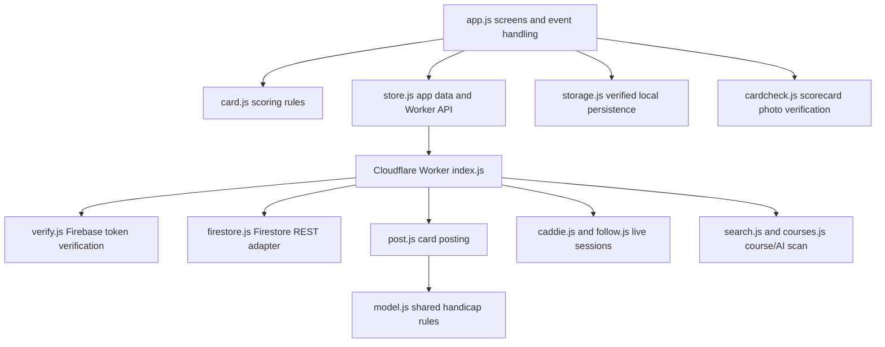

# JavaScript Function Reference — The Marker

**Source reviewed:** `willyros01/marker`, `main`.  
**Purpose:** function-level companion to `APP-CODE-GUIDE.md`. It documents the browser/app JavaScript and the Cloudflare Worker modules that validate and process server-side actions. This is documentation only.

> **Trust boundary:** the phone is an input and display client. The Worker re-checks sensitive operations, reads trusted Firestore records, and writes authoritative results. A value calculated or displayed by the phone is not automatically trusted by the server.

## 1. Application architecture

The major responsibilities are:

- `app.js`: user screens, input handling and local orchestration.
- `card.js`: pure scorecard/handicap rules used by the phone and Worker.
- `storage.js`: durable local card state; a save is read back before it is considered successful.
- `store.js`: Firebase reads/writes and HTTP calls to the Worker.
- `cardcheck.js`: verifies the readings extracted from photographs of a club scorecard.
- `worker/src/index.js`: HTTP routing, authentication gate and scheduled tasks.
- `worker/src/post.js`: authoritative validation and atomic posting into The Scorecard.
- `worker/src/caddie.js`, `follow.js`, `game.js`: server-owned live collaboration state.

## 2. `card.js` — scoring rules and card model

Pure functions only: no Firebase, DOM or network. The same rules are available to the Worker, so server-side posting can recompute scores instead of trusting client totals.

| Function | Purpose and technical behavior |
|---|---|
| `holeOrder(holes, start)` | Builds the ordered sequence of holes for the selected round format and starting hole. Supports front/back/nine-hole and 18-hole order. |
| `startChoices(holes)` | Returns valid starting-hole choices for the selected number of holes. |
| `courseHandicapFor(index, tee)` | Converts a golfer's index into a course handicap using the tee's slope, rating and par. It delegates the core calculation to the shared Scorecard model. |
| `strokesOn(ch, si)` | Determines how many handicap strokes a golfer receives on a hole with the given stroke index. Handles handicaps above 18 by distributing extra strokes over the stroke-index order. |
| `holeCap(par, ch, si)` | Calculates the maximum hole score allowed by the app's pickup/net-double-bogey rule. |
| `grossOn(score, cap)` | Converts a stored hole score/pick-up value into the gross score used in totals, applying the cap consistently. |
| `missedHole(card, player, hole)`, `missedOf(card, player)` | Identify holes a late-joining golfer did not play, distinguishing an unplayed hole from a missing score. |
| `joinedOn(card, player)` | Resolves the hole at which a late-joining player began. |
| `netPar(par, ch, si)` | Calculates the net-par value for a hole using the player's course handicap strokes. |
| `holeInfo(card, hole)` | Produces the computed hole detail for display/score entry: par, stroke index, strokes and relevant score information. |
| `totals(card, player)` | Calculates gross/net and front-nine/back-nine/overall totals for one player, respecting the card's hole order and missed-hole markers. |
| `formatToPar(d)` | Formats a relative-to-par value as E, +N or −N. |
| `holeComplete(card, hole)`, `cardComplete(card)` | Determine whether every player has a score or a valid missed-hole marker for the relevant holes. |
| `newCard({...})` | Constructs the initial card data structure: mode, date, course, tee, hole order, entry method, optional game and players. |
| `setScore(card, playerIndex, hole, value)` | Returns an updated card with a score applied to the selected player/hole. |
| `postable(card)` | Checks whether the card is in a valid completed state for posting. This is a client-side readiness check; the Worker performs its own checks. |
| `canDelete(card)` | Prevents deletion after posting and while a sent posting is in progress. |
| `shareText(card)` | Builds a readable plain-text share summary from the card. |
| `roundFor(card, player, options)` | Converts one player's card into the Scorecard round payload shape, with group/golfer/course/tee IDs and a new round ID. |
| `frozenHoles(tee)` | Tests whether the tee contains enough per-hole par/stroke-index data to support calculations such as late-join/missed-hole scoring. |
| `liveCard(value)` | Normalizes a stored live-session record into the card view shape used by follower/caddie screens. |
| `gameBoard(view)` | Aggregates live game cards into a leaderboard/board view. |

**Important rule:** The client may calculate the screen's provisional total, but the Worker re-derives the authoritative score and handicap when posting. Do not add a second version of the scoring formula in `app.js`.

## 3. `model.js` — shared Scorecard domain logic

This is the shared handicap/domain module also used by The Scorecard. It is intentionally separate from Firebase and screen code.

Key function groups:

- **Identity:** `newId()`, `newJoinCode()`, `normalizeJoinCode()`, `nameKey()`.
- **Handicap:** `differential()`, `handicapIndex()`, `countingRounds()`, `courseHandicap()`, `clampIndex()`, `effectiveIndex()`, `displayIndex()`.
- **20-round window:** `insertIntoWindow()`, `removeFromWindow()`, `mergeWindow()`, `windowToChronological()`, `indexFromWindow()`, `sanitizeWindow()`, `affectsWindow()`.
- **Records:** `buildRound()`, `buildGolfer()`, `buildMember()`, `migrateFromV1()`.
- **Games/rankings:** `gameCovers()`, `gameDays()`, `gameStandings()`, `gameLeaderboard()`, `periodRanking()`, `inPeriod()`, `netScore()`.

The function contracts are the same as documented in The Scorecard JavaScript reference. Keep this copy aligned with Scorecard's active shared model. The Worker imports it directly for posting, so a mismatch can produce a different handicap from the main Scorecard app.

## 4. `cardcheck.js` — scorecard-photo verification

This module is pure validation/normalization logic. The app uses it to explain missing or inconsistent readings; the Worker uses the same logic when deciding whether a course can be accepted into the shared course library.

| Function | Purpose and technical behavior |
|---|---|
| `teeKey(name)` | Normalizes tee labels to a comparison key by lowercasing and removing non-letter characters. |
| `sum(values, holes)` | Sums the specified hole values. Missing values are treated as invalid rather than silently counted as zero. |
| `mergeReadings(readings)` | Combines one or more photo/AI readings for the same physical scorecard. Tracks which holes were read and reconciles front/back-nine totals and tee/rating data. |
| `verifyCard(merged, options)` | Checks the merged reading for complete hole coverage, plausible per-hole pars, consistent nine-hole and 18-hole totals, and tee/rating consistency. Optional lenient yardage mode relaxes yardage checks only. |
| `courseFromCard(merged, {where})` | Converts a verified reading into a normalized course record with tee details and hole data. It does not itself write to Firestore. |

A reading may contain only one nine. Verification is based on the set of holes actually read and the arithmetic consistency of the totals, not merely the number of photographs uploaded.

## 5. `courses.js` and `withdrawn.js`

### `courses.js` — provider adapter (Worker side)

| Function | Purpose and technical behavior |
|---|---|
| `teesFrom(raw)` | Converts provider tee fields into a stable array of tee records. |
| `courseFrom(course)` | Normalizes a provider course result, including location and tees where present. |
| `search(query, key)` | Calls GolfCourseAPI search using the provider authorization key. |
| `byId(id, key)` | Fetches a course detail record; the detail response contains tee and hole-level information. |
| `explain(code)` | Maps provider errors into concise explanations suitable for the UI. |
| Internal `call(url, key)`, `asList`, `holesFrom`, `num` | Handle authenticated HTTP, inconsistent response shapes, hole arrays and safe numeric parsing. |

The key is held by the Worker, not shipped to the phone. The app calls the Worker's course endpoints.

### `withdrawn.js` — withdrawn course/tee rules

| Function | Purpose and technical behavior |
|---|---|
| `lower(value)` | Normalizes a name for case-insensitive matching. |
| `isWithdrawnCourse(course)` | Detects records explicitly marked withdrawn/deleted or carrying a deletion timestamp. |
| `teeWithdrawn(list, courseName, tee)` | Determines whether a particular course/tee configuration matches a withdrawn version. |
| `scorecardIdOf(providerId)` | Extracts the linked Scorecard course ID from the Marker manual-course ID convention (`m-` prefix). |
| `nameWithdrawn(list, courseName)` | Checks whether a course name has a withdrawn version. |
| `summary(docs)` | Converts Firestore course documents into a compact withdrawn-course list. |

Withdrawn course records remain available as historical references for already-posted rounds, but they must not be reused as current scoring inputs.

## 6. `storage.js` — local persistence on the phone

The module prefixes its keys with `marker:` to avoid collisions with The Scorecard, even when both apps share a web origin.

| Function | Purpose and technical behavior |
|---|---|
| `useBackend(backend)` | Injects the selected storage backend. |
| `save(key, value)` | Serializes and persists a value, then reads it back to verify the write. Throws on failure so the UI does not continue with an unsaved score. |
| `load(key, fallback)` | Reads/parses a stored value and supplies a fallback if it is absent. |
| `remove(key)` | Removes one persisted key. |
| `currentCard()`, `saveCurrent(card)`, `clearCurrent()` | Load, save and clear the active unfinished card. |
| `finishedCards()`, `keepFinished(card)`, `dropFinished(id)` | Maintain the local finished-card list. |
| `recentCourses()`, `rememberConfirmed(course)`, `rememberCourse(course)`, `forgetCourse(key)`, `courseKey(course)` | Remember verified/recent courses and avoid duplicate entries by provider ID or normalized manual-course identity. |
| `prefs()`, `savePrefs(prefs)` | Load and merge user preferences without replacing unrelated preference fields. |

**Reliability rule:** a score is not considered saved merely because it changed in JavaScript memory. The storage layer verifies persistence before the app proceeds.

## 7. `store.js` — Firebase and Worker client

This module owns The Marker's Firebase app/auth context and all network calls. It deliberately uses a separate Firebase app name from The Scorecard so anonymous Marker use does not sign the user out of Scorecard.

### Firebase and identity

| Function | Purpose and technical behavior |
|---|---|
| `init()` | Initializes the bundled Firebase SDK, Marker auth and Firestore connection. |
| `onChange(fn)` | Registers an auth/data-state callback. |
| `currentUser()`, `ready()`, `lastProblem()` | Expose the current user, initialization state and most recent problem. |
| `signIn(email, password)`, `sendReset(email)`, `playWithoutAccount()`, `signOut()` | Account sign-in, password reset, anonymous/guest session and sign-out. |
| `myGroups()`, `groupGolfers(assocId)`, `gamesOn(group, date)` | Read the user's groups, roster and games from Scorecard-compatible Firestore records. |
| `library()`, `withdrawnCourses()`, `withdrawnSaved()` | Read the shared course library and withdrawn-course state. |

### Worker communication and course/card operations

| Function | Purpose and technical behavior |
|---|---|
| `workerUrl()` | Resolves the deployed Worker base URL. |
| `callWorker(path, options)` | Adds the Firebase ID token and JSON request body, sends the HTTP request and normalizes the response/error. This is the main app-to-Worker boundary. |
| `searchCourses(query)`, `courseById(id)` | Calls the Worker course-search/detail endpoints. |
| `scanCard(image)`, `scanStatus()`, `verifyCourse(...)` | Send scorecard images for extraction, query remaining scan allowance and request server-side verification. |
| `queuePost(card)`, `waitingToPost()`, `flush()` | Store a finished card for posting, report pending count and retry queued submissions. |
| `submissionCard(card)`, `postOne(card)`, `settle(card, status, reason)` | Build/send a submission, process its server response and update local card status. |
| `deleteCard(id)`, `dropReplaced()`, `removeFromPhone(id)` | Remove local card data or clean up replaced/posted card state, according to the specific operation. |
| `correctableCards()`, `myCards()`, `hideEditable(...)`, `deleteRounds(...)`, `discardEditable(...)`, `cardForCorrection(...)`, `saveCorrection(...)` | Call the Worker correction endpoints. The Worker checks whether the caller may edit and recomputes the resulting rounds. |

### Caddie, Follower and game APIs

| Function | Purpose and technical behavior |
|---|---|
| `caddieStart(card, liveId)`, `caddieStatus(liveId)`, `caddieStop(liveId)`, `caddieJoin(code)`, `caddieSend(liveId, scores, done)` | Create/check/stop a caddie session, join it by code and send score changes to the Worker. |
| `followStart(card)`, `followGame(card)`, `followSend(...)`, `followView(code)` | Create a read-only follower link, publish live scores and fetch the public view. |
| `gameCreate(...)`, `gameJoin(code)` | Create or join a game-following session. |

The Worker—not the phone—owns live IDs, codes, expiry, permissions and the authoritative live record.

## 8. `app.js` — user interface and app orchestration

The app uses one screen-rendering function per major view and a central action dispatcher. It imports `card.js`, `courses.js`, `storage.js`, `store.js` and the shared model. It should coordinate user input, not replace the domain rules or server checks.

### Screen functions

| Screen/function group | Main functions and responsibility |
|---|---|
| Start and account | `screenStart`, `screenSignIn`, `screenSetup`, `refreshMine`, `boot` — choose entry mode, sign-in/guest state and initialize app data. |
| Course selection and recognition | `screenCourse`, `screenReview`, `screenManualCourse`, `courseState`, `readPhoto`, `applyScan`, `refreshScanStatus`, `chooseCourse`, `newManual`, `needHandEntry` — choose/search a course, read photographs, show recognition confidence/problems and support manual entry. |
| Players and scoring | `screenPlayers`, `screenPlayOne`, `screenPlayAll`, `screenHoles`, `screenCard`, `screenFinish`, `screenStatus`, `setScoreNow`, `scoresOf`, `withScores`, `updateCard` — build the player list, enter scores and render card totals/status. |
| Caddie and follower | `screenCaddieMember`, `screenCaddieJoin`, `screenCaddieFinish`, `screenFollowShare`, `screenFollowJoin`, `screenFollowView`, `openFollow`, `watchPoll`, `followNow`, `sendToWatch` — create/join a caddie session, create/open a follower link, refresh a read-only view and synchronize with Apple Watch. |
| Games | `screenGameSetup`, `screenGameShare`, `screenGameView`, `ensureGame`, `gameOnCard` — create/join a game and display its live leaderboard. |
| Corrections and history | `screenCorrections`, `screenCorrectFinish`, `screenHistory`, `screenView`, `screenShare` — list eligible corrections, edit a card, view history and share a result. |
| Shared presentation | `go`, `fail`, `render`, `renderKeepingTyped`, `top`, `banner`, `datePicker`, `niceDate`, `holeHeader`, `cardGrid` — navigation, error state, render preservation and reusable screen fragments. |

### Important asynchronous flows

- `sendSoon()` debounces score transmission so rapid input changes are grouped.
- `sendNow()` sends the current caddie/live-card scores to the Worker and updates local status based on the response.
- `startPolling()` / `poll()` refresh the caddie session while it is active.
- `followSoon()` / `followNow()` publish the scorer's live updates after a short debounce.
- `watchPoll()` refreshes the follower view. It is read-only: follower screens do not call score-write actions.
- `openFollow(code, options)` resolves a follower code and handles retry/ownership state.
- `keepAwake()` requests that the device remain awake during active scoring, where supported.
- `sendToWatch(code, course)`, `watchPlugin()`, `checkWatch()`, `autoLive()` coordinate the native WatchConnectivity bridge and watch support. The watch integration is a platform capability; the JavaScript app sends the minimum session/course context needed by the native watch app.
- `boot()` initializes the app and restores any unfinished local card.

## 9. Cloudflare Worker modules

The Worker is the security and trust boundary. Its endpoints accept a Firebase ID token from the phone, verify the caller, then call focused modules. The service-account key and course-provider key remain server-side secrets.

### `worker/src/index.js` — HTTP router and scheduled entry point

- `fetch(request, env, ctx)` is the Worker HTTP entry. It handles CORS, health checks, Firebase-token verification and endpoint dispatch.
- `fsFor(env)` constructs the Firestore REST client with project and service-account token provider.
- `cors(request, env)` returns the permitted cross-origin headers.
- `reply(body, status, headers)` serializes JSON responses consistently.
- `caller(request, env)` extracts and verifies the Firebase bearer token; anonymous versus signed-in status is carried forward to endpoint policy.
- `scheduled(event, env, ctx)` runs daily cleanup for unused golfers/live cards and scheduled submission sweeps/account-deletion notes for other cron events.

Main route groups:

| Route | Worker module/function | Role |
|---|---|---|
| `GET /health` | router | Health/version check. |
| `GET /search`, `GET /course`, `GET /withdrawn` | `search.js` | Course search, detail and withdrawn list. |
| `GET /scan-status`, `POST /scan`, `POST /verify` | `search.js` | Scan allowance, AI image extraction and course verification. |
| `POST /wake` | `post.js:processSubmission` | Scorer-only retry of a submitted card. |
| `POST /correctable`, `/correction-card`, `/correct`, `/my-cards`, `/hide-editable`, `/delete-rounds`, `/discard-editable` | `correct.js` | Posted-card correction and management. |
| `POST /caddie/*` | `caddie.js` | Caddie live session lifecycle and scores. |
| `POST /follow/*` | `follow.js`, `game.js` | Read-only following and live game sessions. |

The router maps domain refusals to explicit `REFUSED` responses; unexpected infrastructure errors return a retryable service error rather than being reported as a successful write.

### `worker/src/verify.js` — Firebase ID token validation

| Function | Purpose and technical behavior |
|---|---|
| `googleKeys(fetchFn)` | Fetches/caches Google's public signing keys (JWKS) used to validate Firebase ID tokens. |
| `verifyIdToken(token, project, options)` | Validates token signature and claims, including project/audience and expiry, then returns UID, email and anonymous status. |
| Internal `unb64`, `json` | Decode JWT base64url sections and parse their JSON. |

This is authentication, not authorization by itself. Each route/module still checks whether the authenticated caller may perform the requested operation.

### `worker/src/google.js` — service-account access token

| Function | Purpose and technical behavior |
|---|---|
| `signJwt(claims, privateKeyPem, kid)` | Creates and signs a Google service-account JWT assertion using the private key. |
| `accessToken(saJson, fetchFn)` | Exchanges the signed assertion for a Google OAuth access token scoped to Firestore/Datastore. Caches the token until shortly before expiry. |
| Internal `pemBytes`, `b64url`, `b64urlText` | Convert PEM/JWT data to the required binary/base64url representation. |

The service-account JSON is a Worker secret. It must never be returned to the phone or committed into the repository.

### `worker/src/firestore.js` — minimal Firestore REST adapter

| Function | Purpose and technical behavior |
|---|---|
| `fromValue(value)`, `fromFields(fields)` | Convert Firestore REST typed values/documents into ordinary JavaScript values. |
| `toValue(value)`, `toFields(object)` | Convert JavaScript data into Firestore REST typed values. |
| `client({project, token, base, fetchFn})` | Creates the small Firestore client used by the Worker. The injected base URL/fetch function supports testing/emulator use. |
| `setWrite(fs, path, data, options)` | Creates a write descriptor that sets a document with optional existence/update-time preconditions. |
| `updateWrite(fs, path, data, options)` | Creates a masked update descriptor, preserving fields not included in the patch. |
| `deleteWrite(fs, path, options)` | Creates a delete descriptor with optional update-time precondition. |
| `FirestoreError` | Structured error type for REST failures/conflicts. |

The adapter is intentionally golf-agnostic. Domain rules belong in the Worker modules that call it.

### `worker/src/post.js` — authoritative Scorecard posting

| Function | Purpose and technical behavior |
|---|---|
| `checkTee(tee)` | Validates course rating, slope, par and optional hole-level par/stroke-index values; returns a normalized tee. |
| `checkCard(card, today)` | Validates 18-hole order, date, future-date limit, course, player count, unique golfer IDs, missed-hole markers and complete scores. |
| `teeFor(fs, card)` | Prefers the current trusted course-library tee for provider courses; falls back to the card's frozen/manual tee only when appropriate. |
| `matchCourse(courses, name, tee)` | Finds an existing usable Scorecard course/tee match; adds a missing tee or signals that a new course is required. Withdrawn course versions are excluded. |
| `processSubmission(fs, cardId, options)` | Reads the submission, validates/rebuilds its write plan, commits it atomically, marks permanent invalid submissions refused, and retries update-time conflicts. |
| `plan(fs, submission, today)` | Read/validation phase that builds all writes for a card. It checks scorer/group membership, golfer existence/roster/archive state, trusted handicap indexes, course/tee identity and repost constraints. |
| `Refusal`, `STATUS` | Distinguish a permanent domain rejection from a transient infrastructure/conflict failure; status values are sent/posted/refused. |

**Atomicity:** the Worker builds one commit containing one new round per golfer, updated 20-round windows/indexes, directory entries, any required course/tee record and the final submission status. Update-time preconditions protect against overwriting a golfer/card changed between read and commit.

### `worker/src/caddie.js` — caddie session

| Function | Purpose and technical behavior |
|---|---|
| `cleanCode(value)`, `newCode(rand)` | Normalize and generate short join codes, excluding visually confusing characters. |
| `setupFrom(card)` | Creates the limited card setup the caddie needs: course/tee/holes and player names/handicaps. |
| `withLate(setup, players)` | Adds late-joining players to the live setup while preserving hole-order semantics. |
| `cleanScores(raw, setup)` | Validates incoming score payloads against the session's players/holes. |
| `start(fs, who, card, options)` | Creates the owner-authorized live session and code. |
| `status(fs, who, liveId)`, `stop(fs, who, liveId)` | Read/stop the owner's session. |
| `wrongTry(fs, who, now)` | Records failed join attempts to enforce rate limits. |
| `join(fs, who, code)` | Validates the code and gives the caddie only the data required to score. |
| `scores(fs, who, payload)` | Accepts caddie score updates after validating session ownership and participant/score shape. |
| Internal `liveFor`, `handOver`, `view` | Resolve live session state, hand off/restart sessions and construct the limited response view. |

The caddie can enter scores but cannot post the card. The member remains the posting authority.

### `worker/src/follow.js` — read-only follower

| Function | Purpose and technical behavior |
|---|---|
| `start(fs, who, options)` | Creates or attaches a follower code to a live card. |
| `scores(fs, who, payload)` | Receives updates from the scorer/caddie and stores the live state; it is not a follower write endpoint. |
| `view(fs, who, code)` | Resolves a follower code and returns the read-only view, subject to expiry/visibility checks. |
| `gameStart(fs, who, options)` | Starts a live follower session for a game. |
| Internal `wrongFollow`, `liveFor` | Track failed attempts and resolve the live card referenced by a code. |

Followers can view the current card but cannot change scores, player details or posting state.

### `worker/src/game.js` — live game board

| Function | Purpose and technical behavior |
|---|---|
| `newDigits(rand)` | Generates a short numeric game code. |
| `gameOf(fs, uid, card)` | Resolves the game associated with a card and verifies the caller's relationship. |
| `code(fs, game, options)` | Creates/reuses the game's follower code with date-aware identity. |
| `view(fs, codeDoc, options)` | Builds a public live game leaderboard view from the game's live cards. |
| `create(fs, who, payload, options)` | Creates a game-following record for a group/date/course/tee. |
| `join(fs, who, code, options)` | Joins a live game using its code. |

The game view is an aggregate of live cards. The final Scorecard game result remains distinct from the in-progress live gross leaderboard.

### `worker/src/search.js` — course search and AI card scan

| Function | Purpose and technical behavior |
|---|---|
| `count(fs, who, options)` | Enforces per-user/global daily usage limits for search/scan operations. |
| `golfKey(fs, env, options)` | Resolves the server-side GolfCourseAPI key; the phone never receives it. |
| `forgetKey()` | Clears the in-memory provider-key cache. |
| `search(fs, who, query, key)` | Searches courses after usage accounting and normalizes results. |
| `withdrawnList(fs)`, `forgetWithdrawn()` | Loads/caches withdrawn-course information and invalidates that cache when required. |
| `course(fs, who, id, key)` | Fetches a full course/tee detail, checks withdrawn status and stores the reusable course in the shared library. |
| `normalizeScan(raw)` | Normalizes AI output into validated course/tee/hole fields; constrains numeric values to plausible ranges. |
| `scan(fs, who, image, ai)` | Applies quota controls and uses the configured AI binding to read a scorecard image. |
| `scanStatus(fs, who)` | Reports remaining scan allowance. |
| `verify(fs, who, payload)` | Merges stored scan readings, validates them with `cardcheck.js`, and creates/replaces a verified course record subject to authorization. |
| Internal `aiSpent`, `addSpent` | Track AI usage/cost counters and reserve margin. |

### `worker/src/correct.js` — correction and repost authorization

| Function | Purpose and technical behavior |
|---|---|
| `isAppOwner(fs, uid)` | Checks whether a user is the application owner. |
| `myCards(fs, who, options)` | Lists cards visible/eligible for the caller. |
| `correctable(fs, who, options)` | Filters cards the caller may correct based on scorer time window or group owner/admin rights. |
| `hideEditable(fs, who, cardId, options)` | Hides/unhides an editable card in the caller's view without deleting the posted rounds. |
| `discardEditable(fs, who, cardId)` | Discards an editable submission/card under its authorization rules. |
| `cardForCorrection(fs, who, cardId)` | Loads a correction form payload after permission checks. |
| `correct(fs, who, {cardId, scores})` | Validates replacement scores and creates corrected round data while preserving the frozen golfer/course/tee/date/game/handicap context. |
| `deleteRounds(fs, who, cardId)` | Deletes the Scorecard rounds associated with a card under the applicable owner/admin/scorer checks. |
| `repostWrite(fs, submission, oldId)` | Builds the guarded update needed when reposting a card whose prior rounds were removed. |

### `worker/src/cleanup.js` and `fillholes.js`

| File/function | Purpose and technical behavior |
|---|---|
| `noteDeletedAccounts(fs)` | Records/notes account-deletion state for cleanup processing. |
| `cleanGolfers(fs, options)` | Daily cleanup of unused golfer records only when no linked account, roster, round, member, game or Marker card still references them and the required age threshold has passed. |
| `cleanupStatus(fs)` | Reports cleanup candidate/status information without deleting records. |
| `cleanLiveCards(fs, options)` | Removes expired live card/code records in bounded batches. |
| `fillHoles(fs, options)` | One-time migration that fills missing per-hole par/stroke-index fields from the tee frozen on the posted card. It uses guarded commits and supports a preview/no-write mode. |

Cleanup is conservative: historical rounds and referenced golfers must not be deleted merely because a roster entry is absent.

## 10. Configuration and small supporting files

| File | Purpose |
|---|---|
| `firebase-config.js` | Public Firebase client configuration. Security is enforced by Auth, Firestore rules and Worker authorization—not by hiding the client API key. |
| `version.js` | Sets the Marker app version/build identifiers used in diagnostics and release display. |
| `worker/src/google.js` | Service-account JWT signing and OAuth access-token caching for Firestore REST calls. |
| `worker/src/verify.js` | Validates Firebase ID tokens against Google's public signing keys and project claims. |
| `worker/src/firestore.js` | Converts Firestore REST value encodings and performs conditional document writes/transactions. |
| `vendor/firebase/firebase-10.12.0.js` | Pinned, bundled third-party Firebase SDK; generated dependency, not hand-written app logic. |
| Native Watch bridge (Swift) | The app's `sendToWatch()` calls the Capacitor Watch plugin; native WatchConnectivity transfers the session context to the watch app. The watch app independently retrieves the authorized live view. JavaScript does not implement the watch UI itself. |

## 11. End-to-end execution flows

### Enter and post a scorecard
1. `app.js` creates the card using `card.newCard()` and persists each score through `storage.js`.
2. `card.totals()` and related pure functions render provisional gross/net totals.
3. When complete, `store.js` queues a submission and sends it to the Worker.
4. `worker/src/index.js` verifies the Firebase caller and routes the request.
5. `post.js` reloads the submission, validates the card and tee, checks golfer membership/roster/archive state, obtains trusted handicap indexes and builds a commit plan.
6. Firestore conditional writes commit the rounds, golfer windows/indexes, course updates and submission status atomically.
7. The phone reads the posted status and round IDs; it does not declare success merely because the HTTP request was sent.

### Caddie
1. The member creates a live session; `caddie.start()` issues a short code.
2. The caddie joins using `caddie.join()`.
3. Score updates go to `caddie.scores()` and the live document.
4. The member receives the updated card and remains responsible for review and posting.

### Follower
1. The scorer creates a follower link using `follow.start()`.
2. The follower opens the code; `follow.view()` returns a read-only card snapshot.
3. The scorer/caddie publishes changes; the follower refreshes/polls.
4. Follower clients cannot modify the underlying card.

### Apple Watch
1. The phone's `sendToWatch()` passes code/course/session context through the Capacitor plugin.
2. Native Swift uses WatchConnectivity to transfer the context to watchOS.
3. The watch app obtains its own live view and displays hole/group/golfer details.
4. The watch's refresh schedule is constrained by watchOS; it is not a guaranteed always-live network connection.

## 12. Security and reliability rules

- Treat every phone-supplied score, total, course rating, handicap and player/group association as untrusted at the posting boundary.
- Verify Firebase ID tokens in the Worker, then perform route-specific authorization. Authentication alone does not mean the caller owns a card.
- Keep service-account and course-provider credentials in Cloudflare secrets; never return them from an endpoint.
- Use short-lived codes, failed-attempt limits, expiry and least-privilege response payloads for Caddie/Follower.
- Keep follower endpoints read-only from the follower's perspective.
- Use Firestore update-time/existence preconditions to prevent lost updates and duplicate posting.
- Distinguish permanent domain refusal from transient network/conflict failures. Permanent invalid cards should not be retried forever; transient failures should remain retryable.
- Keep the local-save read-back check. Never advance a score screen on a value that only exists in memory.
- When changing shared score/handicap data, update both the client and Worker imports/tests together.

## 13. Source links

- [The Marker JavaScript and Worker source](https://github.com/willyros01/marker/tree/main)
- [The Marker Worker source directory](https://github.com/willyros01/marker/tree/main/worker/src)
- [The Scorecard shared domain model](https://github.com/willyros01/scorecard/blob/main/model.js)
- [Existing illustrated application guide](https://github.com/willyros01/marker/blob/main/APP-CODE-GUIDE.md)
